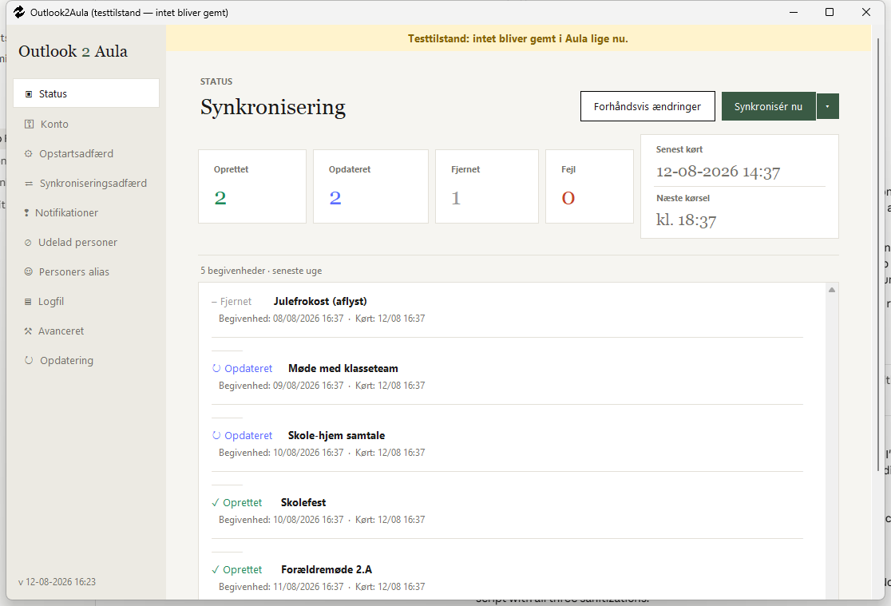
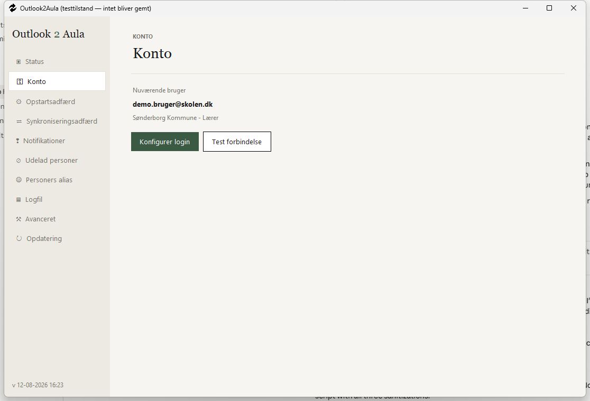
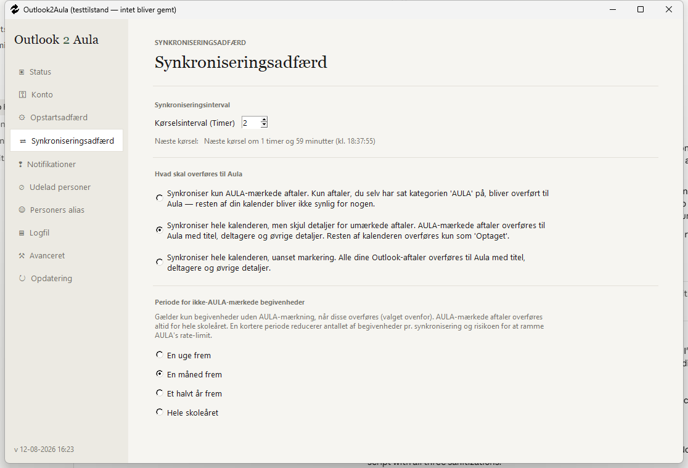
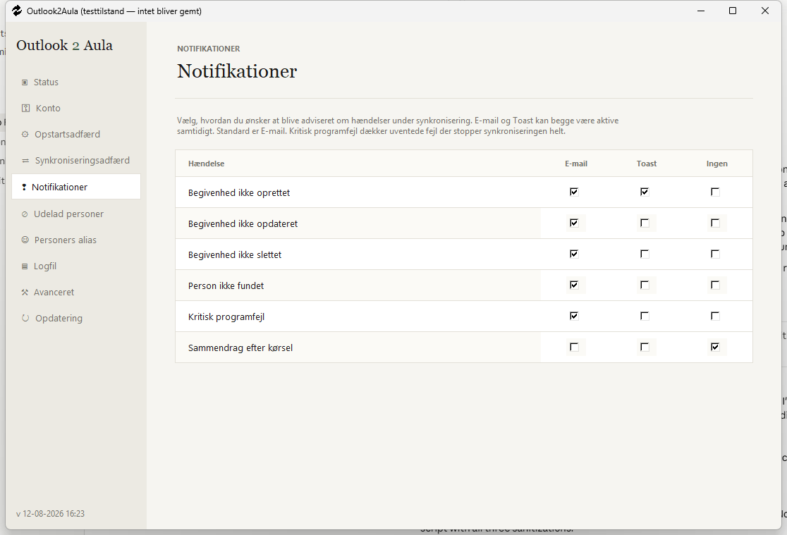
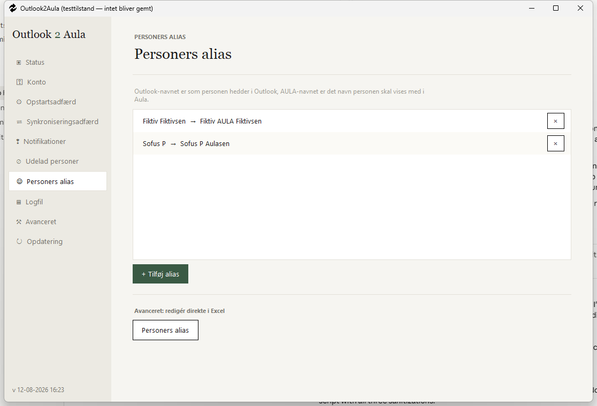
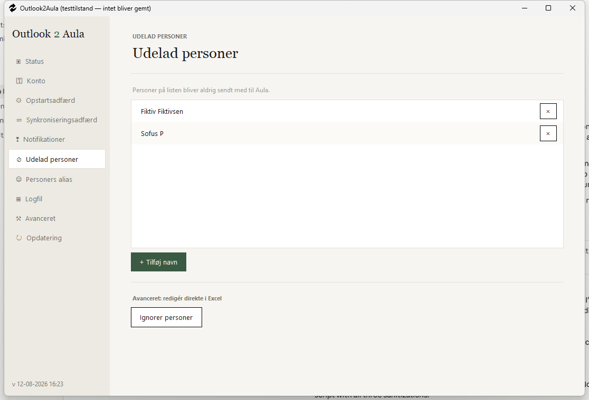
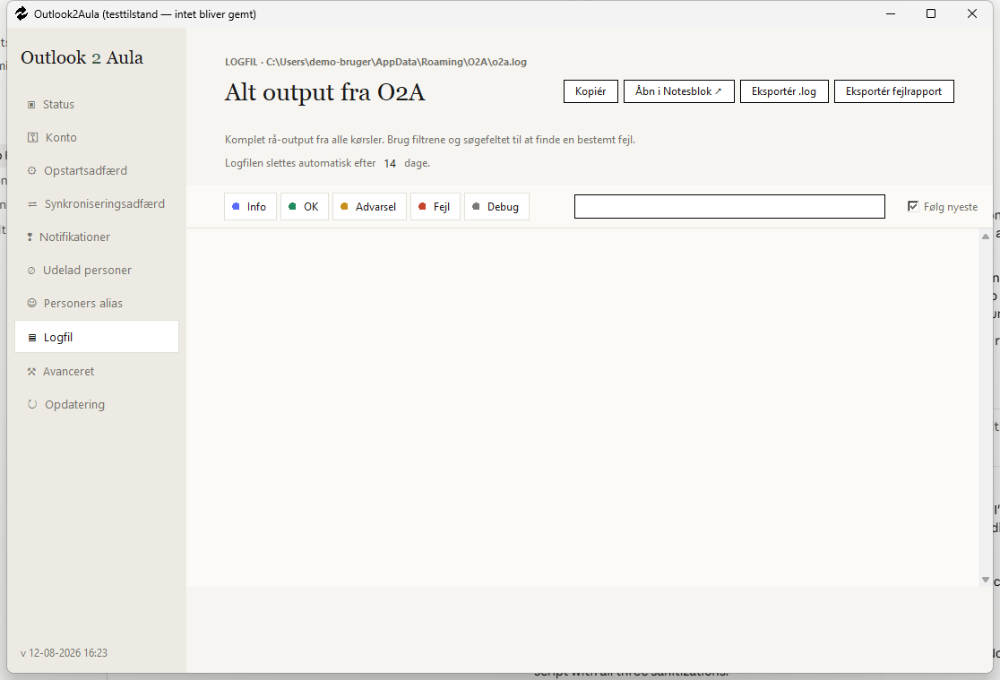
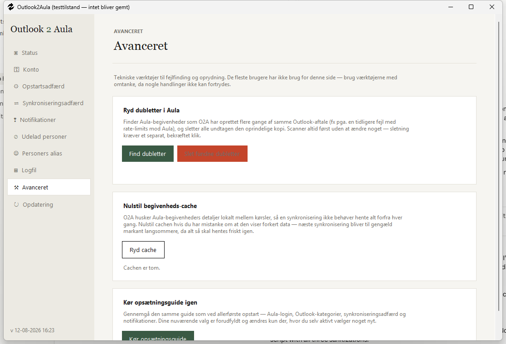

# Outlook2Aula (O2A)

Et grafisk Windows-program, der automatisk synkroniserer din Outlook-kalender med Aula. Du opretter og redigerer aftaler i Outlook som du plejer, mærker dem med kategorien **"AULA"**, og O2A sørger for resten — synkroniseringen går kun én vej, fra Outlook til Aula.

Dette er den grafiske overbygning til det oprindelige "[O2A script](https://github.com/froksen/O2A)".

> [!WARNING]
> **Outlook2Aula vedligeholdes ikke længere.** Den sidste fulde, fungerende version er bevaret som releasen
> [`arkiv-fuld-version-2026-10-12`](https://github.com/froksen/O2A_GUI/releases/tag/arkiv-fuld-version-2026-10-12).
> Brug af programmet indebærer [sikkerhedsrisici](#sikkerhedsrisici-ved-brug-af-den-arkiverede-version), og **al brug sker på eget ansvar**.
> Se [Arkiveret version](#arkiveret-version-arkiv-fuld-version-2026-10-12) for, hvordan den installeres.



## Indhold

- [Hvordan virker det](#hvordan-virker-det)
- [Skærmbilleder](#skærmbilleder)
- [Funktioner](#funktioner)
- [Begrænsninger](#begrænsninger)
- [Tekniske krav](#tekniske-krav)
- [Opsætning og afvikling](#opsætning-og-afvikling)
- [Arkiveret version (arkiv-fuld-version-2026-10-12)](#arkiveret-version-arkiv-fuld-version-2026-10-12)

## Hvordan virker det

Når en aftale oprettes eller ændres i Outlook, tilføjer du kategorien "AULA" til den. Når O2A herefter kører (automatisk med et valgfrit interval, eller manuelt via "Synkronisér nu"), sker følgende:

1. **Login til Aula** — programmet logger ind via UNI-login med dine gemte loginoplysninger.
2. **Outlook-kalenderen læses** — via Windows COM-integration, kun aftaler mærket "AULA" eller "AULA Institutionskalender" (eller hele kalenderen, afhængig af din indstilling — se [Synkroniseringsadfærd](#synkroniseringsadfærd)).
3. **Aula-kalenderen hentes** — via Aulas API, og O2A genkender sine egne tidligere oprettede aftaler.
4. **De to kalendere sammenlignes** — nye aftaler oprettes i Aula, ændrede aftaler opdateres, og aftaler du har slettet i Outlook fjernes igen fra Aula.
5. **Resultatet logges** — i programmets statusvisning, og eventuelt som e-mail eller Windows-notifikation, alt efter dine notifikationsindstillinger.

Det er altid Outlook, der bestemmer — det er en envejssynkronisering, og ændringer foretaget direkte i Aula bliver overskrevet ved næste kørsel.

## Skærmbilleder

<table>
<tr>
<td width="50%">

**Status** — se resultatet af seneste synkronisering, kør en manuel synkronisering, eller forhåndsvis ændringer før de sendes.


</td>
<td width="50%">

**Konto** — se og skift den Aula-konto O2A synkroniserer med.



</td>
</tr>
<tr>
<td width="50%">

**Synkroniseringsadfærd** — vælg kørselsinterval, og hvor meget af kalenderen der skal overføres.



</td>
<td width="50%">

**Notifikationer** — vælg pr. hændelsestype om du vil adviseres via e-mail, Windows-notifikation, ingen af delene.



</td>
</tr>
<tr>
<td width="50%">

**Personers alias** — oversætter et Outlook-navn til det navn, personen skal vises med i Aula.



</td>
<td width="50%">

**Udelad personer** — navne på listen bliver aldrig sendt med til Aula.



</td>
</tr>
<tr>
<td width="50%">

**Logfil** — komplet, søgbart output fra alle kørsler, med filtrering pr. niveau.



</td>
<td width="50%">

**Avanceret** — tekniske værktøjer: dublet-oprydning i Aula, nulstilling af begivenheds-cache, og genkørsel af opsætningsguiden.



</td>
</tr>
</table>

## Funktioner

- Oprette, opdatere og slette heldags- og tidsafgrænsede begivenheder i Aula ud fra Outlook
- Tilføje deltagere fra Outlook-begivenheden til Aula-begivenheden, når de findes på samme institution som dig selv
- Tre niveauer af synkroniseringsadfærd:
  - **Kun AULA-mærkede aftaler** — resten af kalenderen forbliver privat
  - **Hele kalenderen, med skjulte detaljer for umærkede aftaler** — de vises kun som "Optaget" i Aula
  - **Hele kalenderen, uanset markering** — alt overføres med fulde detaljer
- Navne-alias, så et Outlook-navn kan vises med et andet navn i Aula
- En udelad-liste, så bestemte personer aldrig sendes med til Aula
- Forhåndsvisning af ændringer, før de rent faktisk sendes til Aula
- Fleksible notifikationer (e-mail og/eller Windows-notifikation) pr. hændelsestype: mislykket oprettelse/opdatering/sletning, person ikke fundet, kritisk programfejl, eller et sammendrag efter hver kørsel
- Automatisk kørsel i et valgfrit interval (1-4 timer), med mulighed for at sætte den på pause
- Kørsel i baggrunden via systembakken, med genvej til status, indstillinger og manuel synkronisering
- Dublet-oprydning: finder og fjerner Aula-begivenheder som O2A ved en fejl har oprettet flere gange
- Automatisk opdatering af programmet via Git
- Dansk sommer-/vintertid beregnes dynamisk, så programmet ikke er afhængigt af en manuelt vedligeholdt tabel

## Begrænsninger

- **Kun Windows** — kræver Microsoft Outlook installeret lokalt.
- **Ingen tovejssynkronisering** — ændringer foretaget direkte i Aula kan blive overskrevet ved næste kørsel.
- **Gentagne begivenheder synkroniseres ikke korrekt** som ægte tilbagevendende Aula-begivenheder.
- **Vedhæftede filer/medier overføres ikke** fra Outlook til Aula.
- **Frister, påmindelser m.v. overføres ikke.**
- **Kun ca. et år frem** — begivenheder synkroniseres kun frem til cirka ét år fra dags dato.

## Tekniske krav

- Windows med Microsoft Outlook installeret
- Python 3 (se [Requirements.txt](Requirements.txt), som lister afhængighederne)
- (Anbefales) Git, bruges til at holde programmet opdateret

## Opsætning og afvikling

### Nyt: automatisk installation (uden Python eller Git i forvejen)

Hvis du ikke allerede har Python og Git installeret, er det nemmeste at bruge installationsscriptet.

**Hurtigste metode — én kommandolinje:** Åbn PowerShell (almindeligt, *ikke* som administrator — søg efter "PowerShell" i Start-menuen), indsæt linjen herunder, og tryk Enter:

```powershell
[Net.ServicePointManager]::SecurityProtocol = [Net.SecurityProtocolType]::Tls12; iwr https://raw.githubusercontent.com/froksen/O2A_GUI/master/install.ps1 -OutFile "$env:TEMP\o2a-install.ps1"; powershell -ExecutionPolicy Bypass -File "$env:TEMP\o2a-install.ps1"
```

**Alternativ metode — download filerne manuelt:**

1. Hent [`install.bat`](install.bat) og [`install.ps1`](install.ps1) (skal ligge i samme mappe) — fx via "Gem link som" på GitHub, eller ved at hente hele projektet som ZIP og pakke det ud.
2. Dobbeltklik på `install.bat`.

Uanset metode: scriptet forklarer først præcis hvad der vil ske, og beder om din bekræftelse, før noget installeres eller ændres. Derefter installerer det Python og Git per-bruger (kræver **ikke** administratorrettigheder), henter selve programmet til `%USERPROFILE%\Outlook2Aula`, opretter en genvej på skrivebordet, og starter programmet. Kør kommandoen/`install.bat` igen for at reparere eller opdatere installationen.

### Med Git installeret (alternativ)

1. Hent seneste udgave af projektet fra GitHub.
2. Åbn mappen i Stifinder og kør `updateandrun.bat`. Denne fil opdaterer koden (via Git), installerer/opdaterer afhængigheder (via pip), og starter programmet.

### Uden Git installeret (alternativ)

1. Hent seneste udgave af projektet fra GitHub.
2. Installer afhængighederne: `pip install -r Requirements.txt`
3. Start programmet ved at dobbeltklikke på `main.pyw`, eller kør `python main.pyw`.

Ved første opstart guider en opsætningsguide dig igennem Aula-login, Outlook-kategorier, synkroniseringsadfærd og notifikationer. Guiden kan køres igen når som helst fra **Avanceret → Kør opsætningsguide igen**.

Når programmet kører, ligger det i Windows-systembakken. Herfra kan du åbne vinduet, synkronisere manuelt, eller sætte automatisk kørsel på pause.

## Arkiveret version (arkiv-fuld-version-2026-10-12)

Den sidste fulde, fungerende version af Outlook2Aula er gemt som releasen
**[`arkiv-fuld-version-2026-10-12`](https://github.com/froksen/O2A_GUI/releases/tag/arkiv-fuld-version-2026-10-12)**
(commit `ad0b003`). Den er bevaret, så man altid kan vende tilbage til den eller genbruge dele af koden.

> [!CAUTION]
> **Al brug af den arkiverede version sker på eget ansvar.** Programmet vedligeholdes ikke længere, og der kommer
> hverken fejlrettelser eller sikkerhedsopdateringer. Læs [sikkerhedsrisiciene](#sikkerhedsrisici-ved-brug-af-den-arkiverede-version)
> nedenfor, før du installerer det. Er du ansat på en skole eller institution, så afklar brugen med din IT-afdeling
> eller kommunens databeskyttelsesrådgiver (DPO) først.

### Sikkerhedsrisici ved brug af den arkiverede version

- **Ingen sikkerhedsopdateringer.** Opdages der sårbarheder i programmet eller i måden, det logger ind på Aula, bliver de ikke rettet.
- **Uofficiel adgang til Aula.** Programmet bruger ikke en officiel, godkendt integration. Det logger ind ved at efterligne en browser
  (UNI-login-formularer) og kalder Aulas interne, udokumenterede API. Det er ikke godkendt af Aula, KOMBIT eller din kommune,
  kan være i strid med Aulas vilkår eller lokale IT-retningslinjer, og kan holde op med at virke uden varsel.
- **Dine loginoplysninger gemmes på computeren.** Din Aula-/UNI-login-adgangskode gemmes i Windows Credential Manager, og
  personoplysninger i konfigurationsfiler krypteres med Windows DPAPI. Det beskytter mod andre brugere, men **alle programmer og
  personer, der har adgang til din Windows-bruger, kan få adgang til adgangskoden** — og dermed til Aula, hvor der ligger følsomme
  oplysninger om børn og familier.
- **Persondata behandles og overføres.** Programmet læser din Outlook-kalender og overfører titler, beskrivelser og deltagernes navne
  til Aula. Med indstillingen "Hele kalenderen" kan private aftaler blive synlige i Aula. Logfiler og cache i `%APPDATA%\O2A` kan
  indeholde personoplysninger. Ansvaret for, at behandlingen overholder GDPR, ligger hos dig/din institution.
- **Afhængigheder er ikke fastlåst.** `Requirements.txt` angiver kun minimumsversioner, så en ny installation henter de nyeste
  versioner af tredjepartspakker. De kan være inkompatible — eller i værste fald kompromitterede — uden at det bliver opdaget.
- **Programmet skriver direkte i Aula.** Fejl i synkroniseringen kan oprette, ændre eller slette begivenheder i Aula, som andre
  (forældre, kolleger, elever) ser.

### Installation af den arkiverede version

Brug **ikke** `install.bat`, `install.ps1`, `updateandrun.bat` eller `launcher.pyw` til den arkiverede version. De henter altid
den nyeste udgave fra `master`-grenen — ikke arkivet — og virker ikke i en udpakket ZIP-mappe uden Git.

1. Installer **Python 3.12** fra [python.org](https://www.python.org/downloads/windows/). Sæt flueben i *"Add python.exe to PATH"* under installationen.
2. Hent arkivet som ZIP:
   [O2A_GUI-arkiv-fuld-version-2026-10-12.zip](https://github.com/froksen/O2A_GUI/archive/refs/tags/arkiv-fuld-version-2026-10-12.zip)
   (eller vælg *Source code (zip)* på [release-siden](https://github.com/froksen/O2A_GUI/releases/tag/arkiv-fuld-version-2026-10-12)).
3. Pak ZIP-filen ud, fx til `%USERPROFILE%\Outlook2Aula-arkiv`.
4. Åbn PowerShell (ikke som administrator) i den udpakkede mappe — den der indeholder `main.pyw` — og opret et virtuelt miljø med afhængighederne:

   ```powershell
   python -m venv venv
   .\venv\Scripts\python.exe -m pip install -r Requirements.txt
   ```

5. Start programmet:

   ```powershell
   .\venv\Scripts\pythonw.exe main.pyw
   ```

   Ved første opstart kører opsætningsguiden, som beskrevet under [Opsætning og afvikling](#opsætning-og-afvikling).

Bemærk for den arkiverede version:

- **Slå ikke "Start automatisk med Windows" til** i programmets indstillinger. Den genvej peger på `updateandrun.bat`, som ikke virker
  her. Vil du have programmet til at starte automatisk, så lav selv en genvej i `shell:startup` til
  `venv\Scripts\pythonw.exe` med `main.pyw` som argument og den udpakkede mappe som "Start i".
- **Brug ikke knappen "Opdater program".** I en ZIP-installation virker den ikke, og i en Git-installation vil den erstatte
  arkivet med den nyeste udgave fra `master`.

Med Git kan du i stedet hente arkivet direkte:

```powershell
git clone --branch arkiv-fuld-version-2026-10-12 https://github.com/froksen/O2A_GUI.git Outlook2Aula-arkiv
```

Følg derefter trin 4-5 ovenfor.

### Fjern programmet igen

1. Luk programmet (højreklik på ikonet i systembakken → Afslut).
2. Slet den udpakkede programmappe og mappen `%APPDATA%\O2A` (konfiguration, logfiler og cache).
3. Fjern den gemte adgangskode: åbn **Legitimationsstyring** (Credential Manager) → **Windows-legitimationsoplysninger**, og slet posten, hvis navn indeholder `o2a`.
4. Slet eventuelle genveje på skrivebordet og i `shell:startup`.
